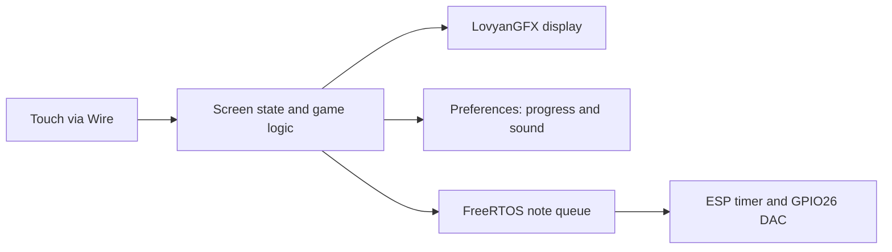

# Naani Crush

An offline ESP32 match-three game with a Desi-themed touchscreen interface, synthesized sound effects, and unlockable memory cards.

The Arduino sketch is in [firmware/NaaniCrush/NaaniCrush.ino](firmware/NaaniCrush/NaaniCrush.ino). Features below are supported by source inspection. This repository has not yet been compile-tested or validated on hardware in this workspace.

## Why this project

Naani Crush combines a familiar puzzle game with a personal memory-card experience for Naani. The sketch includes affectionate messages and rewards each completed level with a collectible card. Barfi, ladoo, jalebi, chai, elephant, and peacock pieces give the game its Desi theme. The creator's fuller build story can be added alongside device photos.

## Key features

- An 8-column × 6-row board with six procedurally drawn piece types.
- Swipe-to-swap input, match detection, clearing, gravity, and cascading matches.
- 24 levels with score targets and move limits; swaps that do not produce a match are reversed without consuming a move.
- Home, level-selection, gameplay, win/loss, collection, and card-detail screens.
- Unlockable cards, collection pagination, and swipe-to-flip card views.
- Persistent level progress, unlocked cards, and sound preference using ESP32 Preferences.
- Queued synthesized sound effects through GPIO26's DAC.
- Offline operation: the sketch contains no Wi-Fi or server integration.

The public sketch omits the uploaded version's ten personal JPEG photos. All cards use its existing text-only fallback; game logic and messages are retained.

## Hardware stack

The sketch identifies **ESP32-2432S022C** and configures an **ST7789** display over an 8-bit parallel bus. The panel is configured as 240×320 and rotated for 320×240 landscape use. Touch is read over I²C using the CST816 register layout at address `0x15`.

Backlight is on GPIO0, touch SDA/SCL on GPIO21/22, and synthesized audio on GPIO26. See [hardware details](docs/hardware.md) for the complete source-configured pin map. The sketch mentions a speaker amplifier; its exact model and electrical wiring are not documented.

Battery-powered operation is part of the original project description. Battery, charging, protection, enclosure, and runtime details are not established by the sketch.

## Software / tech stack

- Arduino C++ and the ESP32 Arduino core.
- LovyanGFX for panel configuration, graphics, text, and JPEG support.
- Wire for direct I²C touch reads.
- Preferences for nonvolatile progress storage.
- ESP timer and FreeRTOS queue APIs for audio scheduling.

The original core and LovyanGFX versions were not supplied. Build compatibility must be established before version pins or validated build claims are added.

## System architecture / how it works

`setup()` initializes the display, touch bus, saved preferences, audio queue/timer, and home screen. `loop()` tracks touch press, movement, and release, then routes gestures to the active screen.

A swipe selects an adjacent board cell. `attemptSwap()` swaps the cells, checks for a match, and reverses unsuccessful swaps. Successful moves resolve cascading matches, update score, and check the level target and move budget. Completed levels unlock cards and save progress.

Audio notes are queued by game events. A timer callback runs every 125 microseconds to synthesize an 8 kHz waveform independently of display drawing. This does not make the entire game nonblocking: match animations still use delays.



## Setup and installation

1. Clone this repository.
2. Install Arduino IDE and the Espressif ESP32 board package.
3. Install **LovyanGFX** through the Arduino Library Manager.
4. Open `firmware/NaaniCrush/NaaniCrush.ino`. The folder and sketch names match Arduino's layout requirements.
5. Select the board profile and serial port appropriate to your ESP32-2432S022C hardware. Confirm the board revision and pin map before flashing; a tested board profile and toolchain versions have not been supplied.
6. Use **Verify**, then **Upload** once the configuration is confirmed. Serial output is configured at **115200 baud**.

No external photo files are required for the public version. See [software setup and validation](docs/software.md) for remaining compatibility checks and a hardware smoke-test checklist.

## Usage

- From the home screen, open level selection or the card collection; toggle sound using the sound button.
- Select an unlocked level and swipe a piece toward an adjacent cell to attempt a swap.
- Reach the score target within the move budget to unlock the level's memory card.
- Swipe to flip a card and use the on-screen navigation to continue or return.
- Browse unlocked cards from the collection. Progress and sound preference are restored on boot.

Exact touch response and physical playback remain unverified here.

## Project structure

```text
naani-crush/
├── README.md
├── LICENSE
├── .gitignore
├── firmware/NaaniCrush/NaaniCrush.ino
├── docs/
│   ├── hardware.md
│   └── software.md
└── assets/
    ├── README.md
    ├── photos/PLACEHOLDER.md
    ├── screenshots/PLACEHOLDER.md
    ├── diagrams/PLACEHOLDER.md
    └── demo/PLACEHOLDER.md
```

## Challenges / engineering decisions

- **Small-screen layout:** a 30-pixel cell grid and landscape panel leave a separate area for score and navigation controls.
- **Touch orientation:** raw controller coordinates are transformed to landscape coordinates in `readTouch()`.
- **Embedded graphics:** themed pieces are drawn with graphics primitives rather than external sprite files.
- **Progress storage:** a bitmask records unlocked cards, while Preferences retains level and sound state.
- **Audio scheduling:** a bounded note queue and timer callback separate synthesis from rendering; short fades reduce abrupt waveform transitions.
- **Public media:** personal photos are excluded while preserving the existing fallback card display.

These choices are visible in the source. Frame rate, input latency, power consumption, and sound quality have not been measured here.

## Future improvements

- Establish and pin a successfully tested board profile, ESP32 core, and LovyanGFX version.
- Add hardware photos, a wiring diagram, and a gameplay recording.
- Document the battery and enclosure design and measure runtime.
- Validate touch mapping, cascading matches, and persistence on the target board.
- Review dead-board handling and long animation delays before extending gameplay.

## License

Code and documentation are covered by the [MIT License](LICENSE). The original personal photos are not distributed. Any future media must be cleared for public display and carry required attribution.
